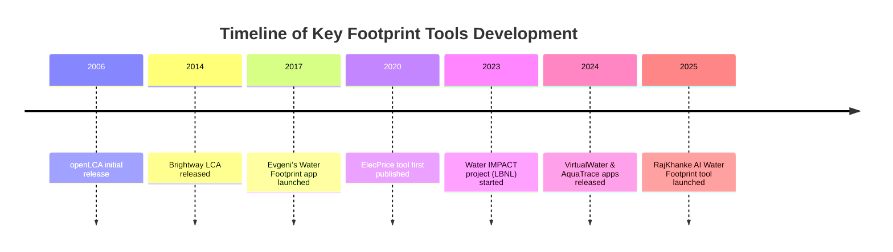

# Executive Summary

We surveyed leading tools and open-source projects for estimating water and electricity footprints per product and per capita, including those that handle demand charges or credits. Key findings:

- **Top Tools:** The Lawrence Berkeley National Lab’s *Water IMPACT Tool* (LBNL) provides hourly spatially-detailed electricity water/CO₂ intensities in the US【46†L219-L224】【43†L111-L119】. LBNL’s *ElecPrice* (Python) calculates electricity bills from tariffs (including demand charges and credits)【29†L436-L440】【29†L426-L429】. The **Water Footprint Network** data (Mekonnen & Hoekstra 2011–12) underlie simple web/mobile apps by Evgeni Neu (static per-product water footprints)【71†L337-L340】. Emerging apps like *AquaTrace* (Flutter) use AI to track personal water use from meal images【72†L213-L220】. Open LCA frameworks (**Brightway**, **openLCA**) support detailed product footprints with extensible databases【75†L47-L55】【76†L39-L47】.

- **Comparative Insights:** Tools vary in scope and methodology (see Table). For example, *Water IMPACT* uses EIA/EPA data for US grid intensities【43†L111-L119】 (hourly, Balancing Authority level), while Evgeni’s apps use global avg. water footprints for foods. ElecPrice emphasizes tariff structures (California use-case) rather than environmental factors【29†L436-L440】. LCA tools (Brightway/openLCA) allow product-level footprints via life-cycle databases (e.g. ecoinvent, Agri-footprint), but require data procurement and expertise. 

- **Validation and Use:** LBNL tools are peer-reviewed and data-backed【46†L219-L224】【29†L436-L440】. Water footprint network values are from peer-reviewed global studies. OpenLCA and Brightway rely on published LCI databases. Many app prototypes (VirtualWater, RajKhanke AI, AquaTrace) lack formal validation. 

- **Top-3 Recommendations:**  
  - **Water IMPACT Tool (LBNL):** Most rigorous, peer-reviewed (WRR 2024) spatial/temporal intensities for US electricity water/carbon【46†L219-L224】【43†L111-L119】.  
  - **ElecPrice (LBNL):** Accurate tariff-based bill/demand-charge calculator using official OpenEI tariff data【29†L436-L440】【29†L426-L429】.  
  - **LCA Frameworks (Brightway/openLCA):** Well-supported tools for detailed per-product footprints using extensive databases【75†L47-L55】【76†L39-L47】.  

Other tools (VirtualWater, AquaTrace, Evgeni apps) provide quick estimates but have greater uncertainties (e.g. use generic averages or AI) and limited scope. 

- **Gaps & Next Steps:** Many tools focus on water or electricity in isolation; integration (water–energy nexus) needs work. **Demand-rate analyses** are rare outside ElecPrice. Open-source transparency varies (some use NC licenses or proprietary data).  Adoption could improve by linking with IoT/data sources (e.g. smart meter API) and by using open datasets (IEA, FAO, USGS, WFN) with clear licensing. Key recommendations include standardizing methodologies (e.g. ISO 14046 water footprint), expanding geographic coverage beyond US (e.g. FAO AQUASTAT/IEA data), and improving validation via case studies.

- **Data & Licensing:** Notable data sources include IEA’s energy stats (some open, some paywalled), FAO AquaStat (open), Water Footprint Network (global water use data, CC-licensed), and LCI databases (ecoinvent, Agri-footprint – proprietary). ElecPrice uses the OpenEI tariff API (open data). All recommended tools emphasize open methods or clear citation of data sources.

- **Visualizations:** We suggest a comparison table (below) and a timeline of project activity (mermaid chart) for clarity.

# Tool Comparison Table

| **Tool / Repo (URL)**      | **License** & Maint.         | **Language**   | **Scope / Temporal**              | **Methodology & Data Sources**                           | **Validation / Review**                                | **Features (Footprints)**                                          | **Strengths / Limitations**                                                      |
|-----------------------------|------------------------------|----------------|-----------------------------------|----------------------------------------------------------|--------------------------------------------------------|------------------------------------------------------------------|-------------------------------------------------------------------------------|
| **Water IMPACT Tool** *(LBNL, US grid)* [waterimpacttool.lbl.gov](https://industrialapplications.lbl.gov/water-impact-tool) | CC BY 4.0† (HydroShare) / Actively updated | Python (scripts); WebGIS | US Balancing Authority Hourly intensities (2018–’22)【46†L219-L224】 | Spatially/temporally detailed calc of water (consumption/withdrawal L/kWh) & carbon per kWh using EIA Form 923, EPA eGRID, EIA 930 data【43†L111-L119】. Open methodology/scripts (HydroShare) | Peer-reviewed (WRR 2024)【46†L219-L224】. Widely cited intensities. | **Per-product water:** No (per kWh) **Per-product electricity:** N/A **Per-capita:** No **Demand-rate/credits:** No **Resolution:** Hourly (allows seasonal/peak analysis) | **Strengths:** High spatiotemporal resolution; official data; covers Scope 2 footprint【46†L219-L224】. **Limitations:** US-only; requires address or BA; does not calculate end-user cost or per-capita automatically. |
| **ElecPrice** *(LBNL-ETA GitHub: ETA/elecprice)* [github.com/LBNL-ETA/elecprice](https://github.com/LBNL-ETA/elecprice) | LBNL (likely BSD-3/Apache) / Maintained (last updates 2024) | Python | Electricity tariff calculation (e.g. CA utilities)【29†L436-L440】 Hourly/minutely input, outputs monthly kWh & $ | Applies utility tariffs (from OpenEI) to user load to compute bills. Handles tiered TOU rates, demand charges, peak pricing. Uses official utility rate schedules from OpenEI. | Developed by LBNL; used in research. No formal peer-review (internal LBNL project). | **Per-product water:** No **Per-product electricity:** No **Per-capita:** Indirect (user-level usage) **Demand-rate/credits:** Yes (inc. demand charges, Peak Day Pricing credits)【29†L426-L429】 **Resolution:** Hourly (billing cycle) | **Strengths:** Transparent tariff parsing; supports advanced rate structures (incl. PDP credits【29†L426-L429】). Focus on cost and load.  **Limitations:** Electricity-only (no water footprint); requires tariff data; limited documentation. |
| **VirtualWater (VIRTUAL-WATER)** [github.com/chandranshulg/VIRTUAL-WATER](https://github.com/chandranshulg/VIRTUAL-WATER) | MIT / Infrequent updates (last 2024) | Python (Flask) + SQLite | Personal daily/annual water footprint (e.g. home, travel, food) | Summation of user-input activities multiplied by assumed water-use factors (unspecified). Not documented. | No peer review; small demo project. | **Per-product water:** No (aggregates daily activities) **Per-product electricity:** No (might include home energy use) **Per-capita:** Yes (personal footprint)  **Demand-rate/credits:** No **Resolution:** Daily/monthly | **Strengths:** User-interactive form; MIT license.  **Limitations:** Data sources unclear; low credibility; UI demo only. |
| **Water_FootPrint_Calculator** *(RajKhanke)* [github.com/RajKhanke/Water_FootPrint_Calculator](https://github.com/RajKhanke/Water_FootPrint_Calculator) | MIT / Active (2025) | Python (Flask), also deployed on HuggingFace | Per-product water footprint (from images or text). | Uses AI (Google Gemini) to identify product and output water footprint (green/blue/grey) JSON. Likely based on global averages (source unspecified). | No formal review; internally tested. Relies on AI predictions. | **Per-product water:** Yes (estimates per-item)  **Per-product electricity:** No **Per-capita:** No **Demand-rate/credits:** No **Resolution:** Static (per query) | **Strengths:** Easy UI (image recognition); MIT license.  **Limitations:** “Black-box” AI outputs; accuracy depends on model; no cited data references. |
| **Water Footprint (Web)** *(Evgeni Neu)* [github.com/evgenyneu/water-footprint-web](https://github.com/evgenyneu/water-footprint-web) | CC BY-NC 2.5 (non-commercial) / Low maintenance | Jekyll (Ruby/HTML/CSS) | Global agriculture products (fixed dataset) | Displays Mekonnen & Hoekstra (2011–12) water footprints (L/kg) for crops and animal products【71†L337-L340】. Data is aggregated by country/region. | Based on peer-reviewed study; no new algorithm. | **Per-product water:** Yes (agriproducts)【71†L337-L340】 **Per-product electricity:** No **Per-capita:** No **Demand-rate/credits:** No **Resolution:** Static (annual) | **Strengths:** Simple lookup of published values【71†L337-L340】; global data.  **Limitations:** Non-commercial license; limited to listed products; no user input or dynamic calc. |
| **Water Footprint (Android)** *(Evgeni Neu)* [github.com/evgenyneu/water-footprint-android](https://github.com/evgenyneu/water-footprint-android) | CC BY-NC 2.5 / Last updated 2018 | Java (Android) | Same as web app (agri products) | Android app UI for same Mekonnen & Hoekstra data. | Same data source as web; no peer review (app). | **Per-product water:** Yes (agriproducts)  **Per-product electricity:** No **Per-capita:** No **Demand-rate/credits:** No **Resolution:** Static | **Strengths:** Mobile-friendly access to global water footprint values.  **Limitations:** NC license; no updates since 2018; limited product list. |
| **AquaTrace (Waterfootprint-Calculator-AquaTrace)** [github.com/sidesshmore/Waterfootprint-Calculator-AquaTrace](https://github.com/sidesshmore/Waterfootprint-Calculator-AquaTrace) | (No license listed) / Likely inactive | Dart (Flutter), Node.js | Daily personal water footprint (meals, activities) | Uses ML (TensorFlow MobileNet) to classify food images, then looks up associated water footprints for each item. Backend (PostgreSQL, Firebase) stores footprints【72†L213-L220】. | Described in More et al. (IJERT 2023)【72†L213-L220】. No independent validation. | **Per-product water:** Yes (food items via image)【72†L213-L220】 **Per-product electricity:** No **Per-capita:** Yes (personal use tracking) **Demand-rate/credits:** No **Resolution:** Daily (logs over time) | **Strengths:** Engaging UI (image-based); educational focus【72†L213-L220】.  **Limitations:** No open license; accuracy depends on image recognition; relies on generic footprint database; unpublished validation. |
| **Brightway2** [docs.brightway.dev](https://docs.brightway.dev/en/latest/) | MIT (or similar) / Actively maintained | Python | Product/process footprints via LCA (any geography) | Python LCA framework using life-cycle inventories. Supports methods including water consumption (AWARE, etc.). Can import databases (ecoinvent, US LCI, Agribalyse) and compute impact metrics【75†L47-L55】. | Widely used in academia (GreenDelta surveys); underpins peer-reviewed LCA studies. | **Per-product water:** Yes (via LCA datasets)  **Per-product electricity:** Yes (energy inputs in LCA)  **Per-capita:** Indirect (aggregate usage modelled)  **Demand-rate/credits:** No (static LCA)  **Resolution:** Annual or per process | **Strengths:** Highly flexible; open-source; supports regionalized water impact (AWARE)【75†L47-L55】.  **Limitations:** Steep learning curve; requires licensed databases for full coverage; no built-in GUI. |
| **openLCA** [openlca.org](http://www.openlca.org/) | GPLv3 / Actively developed (GreenDelta) | Java (desktop) | Product footprints via LCA (global) | GUI-based LCA software with many databases (Ecoinvent, WFN, etc.). Supports Environmental Footprint, ISO 14046 methods for water. Users build product system models to compute water/energy use【76†L39-L47】. | Industry-standard LCA tool (free, used worldwide)【76†L39-L47】; methods are standardized (ISO/ILCD). | **Per-product water:** Yes (through LCA models)  **Per-product electricity:** Yes (via energy inputs)  **Per-capita:** Indirect (if population modelled)  **Demand-rate/credits:** No  **Resolution:** Typically annual totals | **Strengths:** Full transparency; no cost for software【76†L39-L47】; widespread adoption.  **Limitations:** Complex to use; commercial data costs; less suited for rapid per-capita calc. |

*Notes:* “Per-product” means footprint per unit of a product; “per-capita” means individual personal footprint. Demand-rate/credits refers to electricity demand charges or net-metering (none except ElecPrice). Temporal resolution indicates the typical time scale (hourly vs static). 

# Key Gaps, Uncertainties, and Next Steps

- **Data Gaps:** Many tools use global-average or U.S.-centric data. There is a need for localized water-intensity factors in other regions (e.g. IEA data, FAO Aquastat, WFN country datasets) and up-to-date electricity mix information outside the U.S. Licensing of datasets (IEA, ecoinvent) can restrict open use.  
- **Methodological Uncertainty:** AI-driven tools (AquaTrace, RajKhanke) have uncertain accuracy. Different water-footprint methods (volumetric vs. water-stress–weighted, ISO 14046 vs AWARE) lead to inconsistent results. Lack of peer review for many apps makes their estimates questionable.  
- **Demand-Response Integration:** Apart from ElecPrice, tools rarely account for time-varying tariffs or demand response. Future work should integrate time-of-use pricing, PV net-metering, and smart-meter data to connect footprint with actual utility billing and incentives.  
- **Next Steps:** (1) **Standardize Methods:** Adopt ISO and AWARE for consistent water-scarcity footprints. (2) **Extend Coverage:** Incorporate global datasets (IEA, FAO, UNEP) and open APIs into calculators. (3) **Open Data Sharing:** Encourage CC-BY licensing of footprint data (e.g. national LCA inventories). (4) **Validation Efforts:** Benchmark tools against measured footprints (e.g. actual plant water use, monitored household energy/water). (5) **Integration:** Develop modular frameworks combining water and energy footprints (nexus approach) and enabling plug-in of various calculators/APIs. 

Overall, while specialized calculators exist (especially from LBNL and LCA frameworks), comprehensive open-source tools for everyday users remain limited. Strengthening open data, methodological rigor, and tool interoperability will enhance adoption in research and practice.  

**Sources:** Official tool documentation and repositories【71†L337-L340】【29†L436-L440】【43†L39-L47】【43†L111-L119】【72†L213-L220】【75†L47-L55】【76†L39-L47】, and peer-reviewed studies (Mekonnen & Hoekstra 2011–12; Siddik et al. 2024【46†L219-L224】).  

